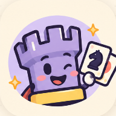

<div align="center">



# Check Happens.

**In Cards we trust.**

Your opening was brilliant. Then someone drew Reverse.

La tua apertura era geniale. Poi qualcuno ha pescato Reverse.

[Play / Gioca](https://outsmarterenri.github.io/CheckHappens/) · [English](#english--meet-the-chaos) · [Italiano](#italiano--benvenuti-nel-caos) · [Technical / Tecnica](#technical-details--dettagli-tecnici) · [Roadmap](#next-milestones--prossime-tappe)

**Playable prototype / Prototipo giocabile · v2.5.0 · iPhone-first · EN / IT**

</div>

## English — meet the chaos

Chess teaches you to plan ahead. **Check Happens teaches you to remain emotionally flexible.**

Play legal chess moves, draw action cards and try to keep your army, your clock and your dignity in roughly the same place. A knight may crack under pressure. A captured rook may return to work. A Reverse may hand your carefully ruined position to your opponent. Rooki approves. Your chess coach has questions.

### Pick your kind of trouble

- **Local:** two people, one phone. Pass the device; take responsibility for your moves.
- **Training:** three bots — Easy ~120, Medium ~200 and Hard ~500 Elo. These are playful estimates, not measured ratings or professional coaching credentials.
- **Private invitations, experimental:** two devices can share a room through the included Node server. **No public multiplayer backend is configured yet.** The Pages site alone cannot connect Internet matches.
- **Learn before blaming the deck:** 16 guided missions, a hands-on card lab and a sandbox for building your own positions.

Choose **4-minute Bullet, 7-minute Blitz or 10-minute Rapid**, then White, Black or Random. These are our custom time-control names. Local and bot matches begin after **3–2–1**; the clock starts after the countdown. White opens, so selecting Black against a bot means the bot moves first.

The interface is built for a single phone screen: card above the board, readable clocks, immediate color/target choices and a very visible Pass button when passing is legal. Six worlds change the scenery — Candy Chaos, Minty Mayhem, Bubblegum Bandit, Peach Please, Cloudy with a Chance of Check and Boo Happens. **Card colors keep their gameplay meaning in every theme.**

### The deck has opinions

| Card          | What happens to your excellent plan                                                                                       |
| ------------- | ------------------------------------------------------------------------------------------------------------------------- |
| **1–9**       | That many moves, using different pieces. Up to the first four are required and safe; later moves tempt fate.              |
| **0 / Reset** | Surviving non-pawn pieces return home. Ordinary pawns stay put. The lost pieces do not get an invitation.                 |
| **Skip**      | Chains an eligible enemy piece for its next controller's turn. It still attacks its squares.                              |
| **Reverse**   | Swaps armies and remaining clocks and rotates the board. Congratulations on your new management position.                 |
| **+2 / +4**   | Revives the maximum available eligible pieces, up to two/four, on free home squares. +4 also lets you choose a color.     |
| **Wild**      | Choose a color and evolve an eligible pawn into a rook, bishop or knight. Queens must use the ordinary promotion process. |

Special cards normally leave one optional move after their effect. A preliminary check defense consumes that optional move.

**Red** takes 3 seconds from your opponent per completed move. **Green** adds 3 seconds to your clock. **Blue** halves break risk on moves 5 and 6. **Yellow** rewards a surviving capturing piece with another required move, using a different available piece.

Move 5 starts the danger zone: **20%, 40%, 60%, 80%, then 99%** break risk. The move and capture happen before the roll. The king cannot move from move 5 onward. Cracks warn you; a puff confirms that your piece has chosen early retirement. Breaking ends the turn. Giving check also ends the turn after the move and its effects resolve.

**Check:** defend before drawing, keeping the previous card color. That defense does not spend the next number card's moves or advance its risk index, but the defending piece has already been used. **Checkmate:** while cards remain, one emergency draw gives you a full rescue turn; it is not an unlimited second-chance machine. After the last card's turn finishes, ordinary single-move chess takes over.

Leaving the table **does not pause the clock**. The device remembers one local match; export its JSON before starting a replacement. Your opponent is not obliged to remind you.

## Italiano — benvenuti nel caos

Gli scacchi ti insegnano a pianificare. **Check Happens ti insegna ad affezionarti meno ai tuoi piani.**

Muovi secondo le regole degli scacchi, pesca carte e cerca di tenere insieme esercito, cronometro e autostima. Una torre catturata può tornare in servizio. Un cavallo può andare letteralmente in pezzi. Un Reverse può trasformare il disastro che stavi costruendo nel problema del tuo avversario. Rooki è soddisfatto. Il tuo maestro di scacchi un po' meno.

### Scegli come metterti nei guai

- **Locale:** due persone e un telefono. Passatevi il dispositivo, senza attribuire al touchscreen le mosse discutibili.
- **Allenamento:** tre bot — Facile ~120, Medio ~200 e Difficile ~500 Elo. Sono stime indicative, non valutazioni misurate.
- **Inviti privati, sperimentali:** due dispositivi possono condividere una stanza tramite il server Node incluso. **Non è ancora configurato un backend pubblico.** Il solo sito Pages non ospita partite su Internet.
- **Prima impara, poi accusa il mazzo:** 16 missioni guidate, laboratorio delle carte interattivo e sandbox per creare posizioni da provare.

Scegli **Bullet da 4 minuti, Blitz da 7 o Rapid da 10**, poi Bianco, Nero o Casuale. Sono i nomi delle modalità del nostro gioco. Le partite locali e contro i bot partono con un **3–2–1**; il tempo comincia a scorrere dopo il countdown. Apre sempre il Bianco: scegliendo il Nero contro un bot, comincia lui.

L'interfaccia è pensata per stare tutta nello schermo del telefono: carta sopra la scacchiera, cronometri leggibili, scelte rapide e pulsante Passa evidente quando è consentito usarlo. Sei temi cambiano l'atmosfera, compresa una versione Halloween. **I colori delle carte mantengono sempre lo stesso significato.** Lingua e movimento ridotto si scelgono nelle Impostazioni.

### Le carte non rispettano il tuo piano

| Carta         | Il piccolo imprevisto                                                                                                                 |
| ------------- | ------------------------------------------------------------------------------------------------------------------------------------- |
| **1–9**       | Concede quel numero di mosse con pezzi diversi. Fino alle prime quattro sono obbligatorie e sicure; dopo comincia la tentazione.      |
| **0 / Reset** | Riporta a casa i pezzi superstiti che non sono più pedoni. I pedoni normali restano dove sono. Nessuna resurrezione.                  |
| **Skip**      | Incatena un pezzo nemico idoneo per il prossimo turno del suo controllore. Il pezzo continua ad attaccare le proprie caselle.         |
| **Reverse**   | Scambia eserciti e tempi residui e ruota la scacchiera. Ora quella posizione è affar tuo.                                             |
| **+2 / +4**   | Resuscita il massimo numero di pezzi idonei possibile, fino a due/quattro, sulle case iniziali libere. Con +4 scegli anche il colore. |
| **Wild**      | Scegli un colore ed evolvi un pedone idoneo in torre, alfiere o cavallo. Per la donna resta la promozione normale.                    |

Le carte speciali lasciano normalmente una mossa facoltativa dopo l'effetto. Un'eventuale difesa preliminare dallo scacco la consuma.

**Rosso:** toglie 3 secondi all'avversario per ogni mossa completata. **Verde:** ne aggiunge 3 a te. **Blu:** dimezza il rischio di rottura sulle mosse 5 e 6. **Giallo:** una cattura, se il pezzo sopravvive, aggiunge un'altra mossa obbligatoria con un diverso pezzo disponibile.

Dalla quinta mossa il rischio sale: **20%, 40%, 60%, 80%, poi 99%**. Prima si risolvono mossa e cattura, poi si tira la sorte. Il re non può muoversi dalla quinta mossa in avanti. Le crepe sono un avviso; il puff è la lettera di dimissioni del pezzo. La rottura termina il turno. Anche dare scacco termina il turno, dopo aver risolto mossa ed effetti.

**Sotto scacco:** prima difendi il re usando ancora il colore precedente, poi peschi. La difesa non sottrae mosse alla carta numerica successiva e non aumenta l'indice di rischio; il pezzo difensore, però, è già stato usato. **Sotto matto:** finché restano carte, una sola pescata d'emergenza concede un turno completo per tentare di salvarsi. Finito il turno dell'ultima carta, si prosegue a scacchi classici con una mossa per turno.

Tornare al menu **non ferma il tempo**. Il dispositivo conserva una sola partita locale: esporta il JSON prima di sostituirla. Rooki non risponde dei ripensamenti.

## Play on iPhone / Gioca su iPhone

Open [Check Happens](https://outsmarterenri.github.io/CheckHappens/) in Safari → **Share → Add to Home Screen**.

Apri [Check Happens](https://outsmarterenri.github.io/CheckHappens/) in Safari → **Condividi → Aggiungi alla schermata Home**.

This is an installable web app, not an App Store package. After an online visit and successful service-worker installation, the cached app supports offline local/bot play. Private rooms require a connection. Updates wait for open app windows to close; finish/export your match, close all windows, then reopen.

È una web app installabile, non un'app dell'App Store. Dopo una visita online e l'installazione del service worker, la versione memorizzata permette di giocare offline in locale o contro i bot. Le stanze private richiedono connessione. Per aggiornare, termina/esporta la partita, chiudi tutte le finestre dell'app e riaprila.

[iPhone notes / Note iPhone](docs/IPHONE.md)

## Technical details / Dettagli tecnici

React 19, strict TypeScript, Vite 6 and a local chess engine behind an adapter. No external chess service or AI API is required. Local/bot matches run entirely in the browser.

React 19, TypeScript strict, Vite 6 e motore scacchistico locale dietro un adapter. Nessun servizio scacchistico esterno né API di IA necessari; partite locali e bot funzionano nel browser.

| Area          | Responsibility / Responsabilità                                                                                                               |
| ------------- | --------------------------------------------------------------------------------------------------------------------------------------------- |
| `src/engine/` | Legal moves, king safety, castling, promotion and en passant / Mosse legali e sicurezza del re.                                               |
| `src/domain/` | State, commands, turn resolver, cards, clocks, bots and deterministic recording / Stato, regole, carte, clock e registrazione deterministica. |
| `src/ui/`     | Phone UI, themes, language, learning and persistence / Interfaccia, temi, lingue, tutorial e salvataggi.                                      |
| `src/online/` | Validated protocol and room client / Protocollo validato e client delle stanze.                                                               |
| `server/`     | Authoritative room server, invitation/seat credentials and disk persistence / Server autoritativo e persistenza.                              |
| `tests/`      | Rule, import, transport, CLI and browser regressions / Test di regole, dati, rete, CLI e browser.                                             |

Human moves, bot choices and clock updates go through the same dispatcher/resolver. Tutorials use the real rules on isolated states. Imported state is checked before use; network commands and replay share a validator. Late room responses cannot replace a newer revision.

Mosse umane, scelte dei bot e aggiornamenti del tempo passano dallo stesso dispatcher/resolver. Il tutorial usa le regole reali su stati separati. Gli import vengono validati; rete e replay condividono il controllo dei comandi. Le risposte di rete in ritardo non sostituiscono revisioni più recenti.

[Architecture](docs/ARCHITECTURE.md) · [Detailed rules / Regole](docs/REGOLE.md) · [Review report / Revisione](docs/REVIEW_2026-10-22.md) · [Changelog](CHANGELOG.md)

### Run locally / Avvio locale

Requires / Richiede **Node.js 22.12+ on 22.x, 24.x or 26+**, and npm.

```sh
git clone https://github.com/OutsmarterEnri/CheckHappens.git
cd CheckHappens
npm ci
npm run dev
```

Open the Vite URL / Apri l'indirizzo mostrato da Vite.

```sh
npm run build
node scripts/serve.mjs          # Local production preview / Anteprima locale
node scripts/serve.mjs --lan    # Same Wi-Fi iPhone test / Prova iPhone sulla stessa rete
```

For LAN testing, keep the computer running. Ordinary HTTP allows gameplay; reliable offline installation needs HTTPS. Windows launchers: `DEV.cmd`, `PLAY.cmd`, `IPHONE.cmd`.

Per le prove in Wi-Fi il computer deve restare acceso. HTTP permette di giocare; per un'installazione offline affidabile serve HTTPS. Launcher Windows: `DEV.cmd`, `PLAY.cmd`, `IPHONE.cmd`.

### Match logs / Log delle partite

**Game options → Save match JSON / Opzioni partita → Salva partita JSON.**

Commands, choices, rejected actions and exact clock samples are recorded. Schema 2 compacts clock samples without dropping their durations/fingerprints. Schema-1 logs and legacy saves remain readable. Session metadata records local/bot context and the build revision. No automatic upload occurs in local/bot play.

Il JSON registra comandi, scelte, azioni rifiutate e campioni esatti del clock. Lo schema 2 compatta i campioni senza perdere durate o impronte dello stato. Restano leggibili schema 1 e vecchi salvataggi. I metadati identificano sessione e build; nelle partite locali/contro bot non ci sono upload automatici.

```sh
npm run analyze:match -- path/to/match.json
npm run analyze:match -- --compact old.json compact.json
npm run analyze:match -- --example example.json
```

Replay verification checks reproducibility with this implementation; it is neither an independent proof of every rule nor a signed anti-cheat record.

La verifica dimostra la riproducibilità con questa implementazione: non è una prova indipendente di tutte le regole né un risultato firmato contro le alterazioni.

[Log format / Formato dei log](docs/MATCH_LOGS.md)

### Checks and deployment / Verifiche e pubblicazione

```sh
npm run check
npm run build:server
npx playwright install chromium
npx playwright test --workers=2
npm audit
```

Verified baseline / Verifiche effettuate: **195 unit tests + 68 Chromium browser tests**, strict TypeScript, production/server builds and historical replay fixtures. Real iPhone/Safari testing is still needed for native status bars, gestures and accessibility text sizes.

Pushes to `main` run verification. Publishing uses the manual **Deploy Check Happens to Pages** workflow, which verifies the code and publishes only `dist/`. Pages hosts the frontend, not the Node server.

I push su `main` avviano le verifiche. Il deploy usa il workflow manuale **Deploy Check Happens to Pages**, che verifica il codice e pubblica solo `dist/`. Pages ospita il frontend, non il server Node.

[Pages guide / Guida Pages](docs/PAGES.md) · [Test notes / Note di verifica](docs/TESTING.md) · [Private-room setup / Stanze private](docs/PRIVATE_MATCHES.md)

## Next milestones / Prossime tappe

These are planned directions, not shipped features or promised dates.

Sono obiettivi di sviluppo, non funzionalità già disponibili o date promesse.

| Priority                     | English                                                                                                                                 | Italiano                                                                                                                                |
| ---------------------------- | --------------------------------------------------------------------------------------------------------------------------------------- | --------------------------------------------------------------------------------------------------------------------------------------- |
| **1 — Real phones**          | Playtest full matches on iPhone, including install/update, notch, safe areas, gestures and larger text.                                 | Provare partite complete su iPhone: installazione, aggiornamenti, notch, gesti e testo ingrandito.                                      |
| **2 — Rules under pressure** | Analyze real match logs and add independent regressions for rare card/check/material combinations.                                      | Analizzare i log reali e aggiungere regressioni indipendenti per combinazioni rare di carte, scacco e materiale.                        |
| **3 — Public private rooms** | Host the existing backend with HTTPS and persistent storage; test proxy limits, invitation recovery and reconnect across real networks. | Ospitare il backend con HTTPS e disco persistente; verificare limiti del proxy, recupero degli inviti e riconnessioni tra reti diverse. |
| **4 — Better training**      | Improve bot decisions from playtests and measure difficulty before treating Elo labels as ratings.                                      | Migliorare le decisioni dei bot e misurare la difficoltà prima di attribuire valore alle etichette Elo.                                 |
| **5 — Release polish**       | Continue accessibility checks and simplify UI modules where a concrete maintenance problem appears.                                     | Proseguire le verifiche di accessibilità e semplificare i moduli UI dove emerge una necessità concreta.                                 |

## Limits and data / Limiti e dati

- **One local save / Un salvataggio locale:** device and origin specific. No account or cloud sync. Export before replacing it or clearing browser data. / Legato a dispositivo e origine; nessun account o cloud. Esporta prima di sostituirlo o cancellare i dati.
- **Clocks keep running / Il tempo continua:** menus and leaving the app do not pause an active match. / Menu e uscita dall'app non mettono in pausa la partita.
- **Experimental multiplayer / Multiplayer sperimentale:** single-process Node server, disk snapshots and limited room capacity. No public backend configured; public-load guarantees have not been established. / Server a processo singolo, snapshot su disco e capacità limitata; nessun backend pubblico configurato o garanzia di carico pubblico.
- **Known approximations / Approssimazioni dichiarate:** conservative dead-position/timeout material evaluation in exceptional chess positions; heuristic bots with uncalibrated Elo. / Valutazione conservativa di posizioni morte/materiale nei casi eccezionali e bot con Elo non calibrato.
- **Privacy:** local/bot games do not upload match data. Private rooms send commands to the selected server, which stores match data and hashed credentials. No analytics are implemented; hosting providers may process connection data. / Nessun upload nelle partite locali/contro bot. Le stanze private inviano comandi al server scelto, che conserva dati e credenziali in forma hash. Nessuna analytics implementata; gli host possono trattare dati di connessione.

Found a bug? [Open an issue](https://github.com/OutsmarterEnri/CheckHappens/issues) with expected/actual behavior, device/browser and a relevant JSON log. Check attachments before posting: issues may be public.

Hai trovato un bug? [Apri una issue](https://github.com/OutsmarterEnri/CheckHappens/issues) indicando comportamento atteso/reale, dispositivo/browser e, se utile, il JSON della partita. Controlla gli allegati: le issue possono essere pubbliche.

## Rights and licenses / Diritti e licenze

**Project-authored code, documentation and assets remain reserved. This is not an open-source release.** The root [LICENSE](LICENSE) is a rights notice; `package.json` declares `UNLICENSED`. Publishing the repository or website does not grant MIT/GPL reuse rights. Public browser-delivered code remains downloadable, and GitHub's platform terms still apply.

**Codice, documentazione e asset del progetto restano riservati. Non è una pubblicazione open source.** [LICENSE](LICENSE) contiene l'avviso sui diritti; `package.json` dichiara `UNLICENSED`. La disponibilità del repository o del sito non concede una licenza MIT/GPL di riutilizzo. Il codice inviato al browser resta scaricabile e si applicano i termini della piattaforma GitHub.

Third-party licenses apply separately. React, React DOM and Scheduler use MIT. Their notices and Vite's supplied license notices are preserved; development skills and review tools are not game runtime dependencies.

Le licenze dei componenti di terzi restano applicabili separatamente. React, React DOM e Scheduler usano MIT; gli avvisi e le licenze fornite da Vite sono conservati. Skill e strumenti di revisione non sono dipendenze runtime del gioco.

[Third-party notices](THIRD_PARTY_NOTICES.md) · [Dependency license inventory](docs/DEPENDENCY_LICENSES.md) · [Rights notes / Note sui diritti](docs/RIGHTS.md)

An independent prototype, not an official or endorsed Mattel product. UNO is a Mattel brand; inspiration does not grant trademark or artwork rights. The Check Happens name has not undergone trademark-clearance review.

Prototipo indipendente, non ufficiale né approvato da Mattel. UNO è un marchio Mattel: l'ispirazione non concede diritti sul marchio o sui suoi asset. Il nome Check Happens non è stato sottoposto a una verifica di disponibilità del marchio.
