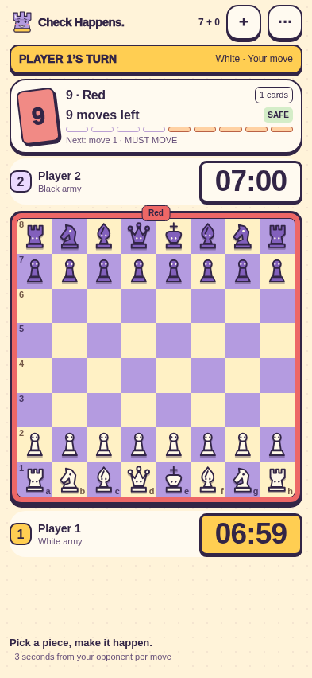

# Check Happens.

### In Cards we trust

**Chess, action cards, and plans that rarely survive the next draw.**

Check Happens is an independent experimental web game for two players on one device, one player against a local training bot, or two devices through a private room server. It combines legal chess moves with colored cards that change move budgets, clocks and even who controls each army.

The interface supports English and Italian, designed around a single iPhone portrait screen, with a playful cartoon style and direct touch controls. Local and bot games run entirely in the browser. Private invitations use the included authoritative Node server; no account system is required.



**Status:** playable prototype, version 2.5.0. **Project code:** reserved, not open source. **GitHub Pages:** frontend published; private Internet matches require a separately hosted HTTPS server.

## What you can play

- **Local match:** two people pass one phone between turns.
- **Training:** Easy, Medium and Hard bots, with approximate labels of 120, 200 and 500 Elo. Their strategies differ; these are not measured ratings.
- **Private match:** invitation link, two devices, authoritative clocks and reconnect. [Server setup](docs/PRIVATE_MATCHES.md).
- **Themes:** Candy Chaos plus five alternative worlds, saved in Settings.
- **Time controls:** 4-minute Bullet, 7-minute Blitz and 10-minute Rapid, per player. These are this game's custom mode names.
- **Learning hub:** separate card lab, 16 interactive challenges with goals, hints and outcome feedback and a free position sandbox; all fit the phone viewport without scrolling.
- Reduced-motion settings, automatic on-device saving and match JSON export/analysis.

The board frame remembers the active card color. The turn banner identifies the player and controlled army. The move counter separates remaining actions and required bonuses. Skip chains lock the affected piece. Risky pieces show progressively stronger cracks based on their effective break chance and shake before a move; a broken piece disappears with a puff. Win/Lose/Draw finales offer review, replay export and a rematch.

## How a turn works

Normally, a player automatically draws a card, adopts its color, resolves its effect and makes the available moves. A piece can be used only once within an action-card turn. Giving check ends the current turn after resolving the move and its effects.

| Card | Effect |
|---|---|
| Number 1–9 | Grants that many moves with different pieces. The first four are safe and required; later moves may be passed unless a required bonus remains. |
| 0 / Reset | Returns surviving non-pawn pieces home; ordinary pawns stay. It does not resurrect pieces. |
| Skip | Freezes an eligible enemy piece for its next controller's turn. |
| Reverse | Exchanges armies and remaining clocks, rotates the board, and lets the active player use the received army. |
| +2 / +4 | Revives as many eligible lost pieces as possible, up to two/four, on free original squares. +4 also asks for a color. |
| Wild | Chooses a color and evolves an eligible pawn into a rook, bishop or knight. |

Special cards normally leave one optional move after their effect; defending check can make a remaining action mandatory.

| Active color | Effect per completed move |
|---|---|
| Red | Removes 3 seconds from the opponent. |
| Green | Adds 3 seconds to the active player. |
| Blue | Halves break risk on moves 5 and 6. |
| Yellow | A capture grants another required move with a different available piece. |

Break risk starts at move 5: **20%, 40%, 60%, 80%, then 99%**. A risky move and its capture resolve before the break roll. The king cannot be used from move 5 onward. Breaking ends the turn.

**Under check:** defend before drawing, with the previous color still active. This defense does not reduce a following number card's move budget or advance its risk index, but it consumes a special card's optional move. **Under checkmate:** while cards remain, one emergency draw can rescue the position; it is a full turn, not an unlimited redraw. A Reverse can transfer a losing army to the other player. When the deck is exhausted, play transitions to ordinary single-move chess.

The in-app tutorial introduces the controls. [Original detailed rule notes](docs/REGOLE.md) and [archived specification](docs/SPECIFICA.md) remain in Italian and include historical defaults superseded by the modes listed above.

## Run locally

Requires **Node.js 22 or newer** and npm. No API keys are required.

```sh
git clone https://github.com/OutsmarterEnri/CheckHappens.git
cd CheckHappens
npm ci
npm run dev
```

Open the local URL printed by Vite. Choose **Play**, a time control, and local play or a bot.

For the production build:

```sh
npm run build
node scripts/serve.mjs
```

Windows launchers: `DEV.cmd` installs dependencies and starts development; `PLAY.cmd` serves an existing build; `IPHONE.cmd` serves an existing build on the local network. The original launcher names remain as aliases.

## Play on iPhone

For local Wi-Fi testing, build first and run:

```sh
node scripts/serve.mjs --lan
```

Open the printed LAN address in Safari while the phone and computer share Wi-Fi. The computer must remain running. Ordinary LAN HTTP supports gameplay, but secure HTTPS hosting is needed for reliable service-worker offline caching on iPhone.

For a hosted test, use the **GitHub Pages guide below**. Once published, open the HTTPS site in Safari and use **Share → Add to Home Screen** if desired. This is a web app, not a native App Store package. See [iPhone notes](docs/IPHONE.md).

## Publish a test build on GitHub Pages

Expected address after the first successful deployment:

`https://outsmarterenri.github.io/CheckHappens/`

The included [Deploy Check Happens to Pages workflow](.github/workflows/pages.yml) runs **manually**, on `main`. It verifies and builds the project, then publishes **only `dist/`**. A normal push does not deploy the game.

1. Commit and push these prepared files to `main`.
2. In the repository, open **Settings → Pages → Build and deployment → Source → GitHub Actions**.
3. Open **Actions → Deploy Check Happens to Pages → Run workflow**, select `main`, then run it.
4. Wait for the verification/build and deployment jobs to finish successfully. Open the URL shown by the `github-pages` environment.
5. On iPhone, test a local match, a bot match, JSON export, resume, and a reload after visiting online once.

For each later test release, push the reviewed changes and run that workflow again. No custom domain or paid hosting is required for a public repository on GitHub Free. Pages availability for private repositories depends on the GitHub plan. **A standard Pages URL is publicly reachable; it is not a private invite-only beta.**

Detailed setup, permissions, update behavior and troubleshooting: [GitHub Pages publication guide](docs/PAGES.md).

## Match logs and diagnostics

Open **Game options → Save match JSON**, **Verify this match**, or **Analyze JSON file**.

Every resolver command is recorded, including card choices, bot actions, rejected moves and exact clock samples. Compact schema 2 groups consecutive clock samples without discarding their durations or fingerprints, and omits duplicated checkpoints. Original schema-1 logs and legacy saves remain readable.

Recording sessions identify local/computer mode, bot difficulty and the build's application version, Git revision and source fingerprint. Unknown context from older logs stays unknown. Exported logs remain on the device until shared.

```sh
npm run analyze:match -- path/to/match.json
npm run analyze:match -- --compact old.json compact.json
```

The analyzer re-executes the covered actions and reports the first divergence, plus a summary derived from verified replay. Consistent replay checks this implementation; it does not prove every game rule is correct or establish anti-cheat authenticity. See [log format and limits](docs/MATCH_LOGS.md).

## Development and verification

```sh
npm run check
npx playwright install chromium
npx playwright test --workers=2
```

`npm run check` runs strict TypeScript, domain tests and a production build. Browser tests start their own servers and exercise phone layouts, tutorial, three bot profiles, card interactions, logs, finales and offline reload. The last verified baseline has **176 unit tests and 68 Chromium browser tests**. Physical iPhone/Safari release testing remains necessary.

The implementation uses React, TypeScript and Vite, with a local chess-engine adapter and a deterministic turn resolver. [Architecture](docs/ARCHITECTURE.md) · [verification report](docs/TESTING.md) · [changelog](CHANGELOG.md).

## Current limits and data

- Private rooms are implemented and tested locally with two browser clients. No public backend is configured yet. GitHub Pages serves only the frontend; use the included server on your LAN or deploy it separately with HTTPS. [Private matches](docs/PRIVATE_MATCHES.md).
- Leaving the table does not pause the clock. Resume accounts for elapsed time. A new match replaces the single local save: export before replacing it.
- Storage is best-effort. Clearing browser data, changing browser/device/origin, or exhausting storage can lose the on-device save. The local development URL and Pages URL have separate saves.
- Local/bot games do not upload matches. Private mode sends commands to the selected room server, which stores game logs and hashed seat credentials. No analytics or accounts are implemented. GitHub and the chosen backend host may process connection information, including IP addresses.
- The local engine's dead-position/timeout material evaluator is conservative and does not cover every exceptional chess position. Bots are heuristic training opponents, not certified Elo engines.
- Lab fixtures and ordered decks are debugging starting positions. They replace the current table and are not ordinary match history.

Report rule or interface problems through [GitHub Issues](https://github.com/OutsmarterEnri/CheckHappens/issues). Include expected behavior, device/browser, build context and an exported match log when relevant. Review files before posting: issues and attached logs may be public. Do not submit secrets or unrelated personal information.

## License, ownership and third-party rights

**The project owner has chosen to keep project-authored code, documentation and assets reserved for now.** The root [LICENSE](LICENSE) is a rights notice, not an open-source license; `package.json` declares `UNLICENSED`. This does not mean the public repository is confidential, revoke GitHub's viewing/forking permissions, or prevent users from downloading browser-delivered JavaScript. No MIT/GPL reuse grant is made for project-authored materials.

Third-party licenses continue to apply separately. React, React DOM and Scheduler use MIT; their copyright and permission notices are preserved. Vite's core license and supplied bundled-tool notices are also retained. See [third-party notices](THIRD_PARTY_NOTICES.md), [the dependency inventory](docs/DEPENDENCY_LICENSES.md), and the deployed `THIRD_PARTY_NOTICES.txt` file.

This is an independent prototype, not an official or endorsed Mattel product. UNO is a Mattel brand; references describe inspiration and terminology, not a license to use its branding, artwork or trade dress. The availability of source code or the choice of a software license does not clear trademark, asset or commercial-distribution rights. The name **Check Happens** has not undergone a trademark-clearance review. See [rights and release notes](docs/RIGHTS.md) before wider distribution or monetization.

### Language and phone controls

Choose **Settings → Language → English / Italiano**. The choice is saved on this
device and applies to menus, the tutorial, card choices, turn feedback and results.
Match JSON diagnostics remain in English for reproducible analysis. The card panel
sits above the board; larger clocks and highlighted Pass/List actions keep the
board and turn controls within easier thumb reach. The installed iOS safe-area
header workaround is preserved.

Before starting, choose **White / Black / Random**. In a local game this sets
Player 1's starting army; against a bot it sets your army. White always opens,
so the bot goes first when you choose Black. Reverse still swaps armies and
clocks during play. Random is resolved once per new match from its random seed.
Selecting Local match or Train with a bot starts a **3–2–1 countdown** and then
draws the first card automatically. The game clock starts after the countdown.
Saved matches resume directly; the laboratory retains a manual start for scenarios.

### Six worlds, one deck

Settings changes the complete visual world: Candy Chaos comic paper, Minty Mayhem
forest night, Bubblegum Bandit bubble pop, Peach Please desert sunshine, and Cloudy
with a Chance of Check blueprints, plus Boo Happens Halloween nights. Surfaces, board squares, chess pieces, controls,
feedback and the Rooki mascot follow the selected world. Drawn card faces, color
choices and the active-color board frame retain their fixed gameplay colors.

Rooki uses the owner-supplied illustrated mascot, five original theme variants and a new Halloween costume: tap to greet it. The wordmark, loading screen and installable icons share the illustrated identity. Motion follows
the saved preference and the device's reduced-motion setting. Theme selection is
saved on this device; all six worlds fit the existing single-screen phone layout.

Menu and learning navigation supports a rightward swipe starting within 24px of
the left edge, alongside the visible Back/Home buttons. Forms and chessboard
touches are excluded. Match navigation preserves the existing save/clock behavior;
leaving the table does not pause a running clock. See [project status](docs/STATUS.md).

The clubhouse menus share the table’s illustrated, tactile style: a layered chess/card
hero, a dominant Play action, compact mode cards and an illustrated theme gallery.
Local/private play, training, clock/side selection and all saved preferences retain
their existing behavior.
